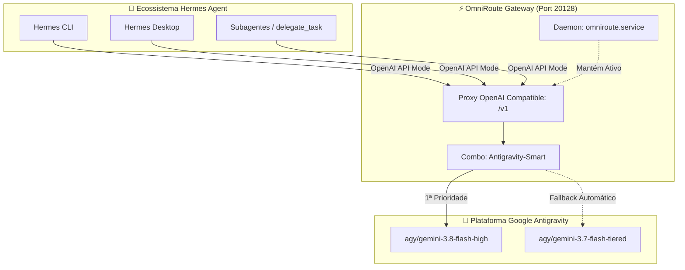

# 🚀 Central de Navegação — Hermes + OmniRoute + Antigravity

> **Bem-vindo ao Vault do Guia Oficial de Integração.**
> Este cofre foi desenhado especificamente para leitura e navegação no **Obsidian**, interligando a arquitetura, etapas de configuração, scripts e troubleshooting através de links bidirecionais (Wikilinks).

---

## 🗺️ Mapa de Conteúdo (MOC)

```
┌── 01 - Visão Geral & Arquitetura
│   ├── [[01 - Visão Geral/01.1 - Topologia e Arquitetura|01.1 - Topologia e Arquitetura da Solução]]
│   └── [[01 - Visão Geral/01.2 - Benefícios do Ecossistema|01.2 - Por Que OmniRoute + Antigravity?]]
│
├── 02 - Instalação & Configuração
│   ├── [[02 - Instalação & Configuração/02.1 - Google Antigravity CLI|02.1 - Instalação do Antigravity CLI]]
│   ├── [[02 - Instalação & Configuração/02.2 - OmniRoute AI Gateway|02.2 - Instalação do OmniRoute]]
│   ├── [[02 - Instalação & Configuração/02.3 - Provedor Antigravity no OmniRoute|02.3 - Conexão OAuth Antigravity (agy)]]
│   ├── [[02 - Instalação & Configuração/02.4 - Model Combo Antigravity-Smart|02.4 - Configuração do Combo Antigravity-Smart]]
│   ├── [[02 - Instalação & Configuração/02.5 - Chaves de API e Isolamento|02.5 - Emissão de Chaves de API & Segurança]]
│   ├── [[02 - Instalação & Configuração/02.6 - Daemon Systemd de Usuário|02.6 - Provisionamento do Serviço Systemd]]
│   ├── [[02 - Instalação & Configuração/02.7 - Configuração do Hermes Agent|02.7 - Configuração Completa do Hermes Agent]]
│   └── [[02 - Instalação & Configuração/02.8 - Instalação e Configuração no Windows|02.8 - Guia de Instalação e Setup no Windows]]
│
├── 03 - Validação & Smoke Tests
│   ├── [[03 - Validação & Smoke Tests/03.1 - Testes Automatizados (Script)|03.1 - Execução do Script de Smoke Test]]
│   └── [[03 - Validação & Smoke Tests/03.2 - Testes Manuais (cURL & Hermes CLI)|03.2 - Verificação Manual via cURL e CLI]]
│
├── 04 - Operação & Troubleshooting
│   ├── [[04 - Operação & Troubleshooting/04.1 - Guia de Solução de Problemas|04.1 - Matriz de Resolução de Erros]]
│   ├── [[04 - Operação & Troubleshooting/04.2 - Manutenção e Rotação de Tokens|04.2 - Manutenção e Ciclo de Vida de Tokens]]
│   └── [[04 - Operação & Troubleshooting/04.3 - Padronização de Subagentes e Perfis|04.3 - Padronização para Subagentes e Perfis]]
│
└── 05 - Anexos & Referências
    ├── [[05 - Anexos & Referências/Perfis Base/README|Perfis Base de Fundação: Forge & Potz]]
    │   ├── [[05 - Anexos & Referências/Perfis Base/SOUL-Forge|SOUL.md do Forge (Platform & SRE)]]
    │   └── [[05 - Anexos & Referências/Perfis Base/SOUL-Potz|SOUL.md da Potz (Agent Resources)]]
    ├── [[05 - Anexos & Referências/Arquivo config.yaml Explicado|Template config.yaml Comentado]]
    ├── [[05 - Anexos & Referências/Arquivo .env Explicado|Template .env Comentado]]
    └── [[05 - Anexos & Referências/Unit omniroute.service Explicada|Unit omniroute.service Comentada]]
```

---

## 🏛️ Diagrama de Fluxo Visual



---

## ⚡ Guia Rápido (TL;DR)

1. **Configuração do Gateway:**
   - O OmniRoute roda localmente na porta `20128` via systemd (`systemctl --user status omniroute.service`).
2. **Modelo Definido:**
   - O modelo registrado no Hermes é `Antigravity-Smart` com provedor `openai-api`.
3. **Endpoint Base:**
   - `http://127.0.0.1:20128/v1`
4. **Smoke Test Rápido:**
   - Execute `./scripts/test-omniroute-hermes.sh` na raiz deste cofre para testar toda a cadeia.

---

> [!TIP]
> **Dica de Visualização no Obsidian:**
> Pressione `Ctrl + G` (ou abra a visualização em Grafo) para ver a teia de relações entre a arquitetura, os scripts e as configurações deste guia!
