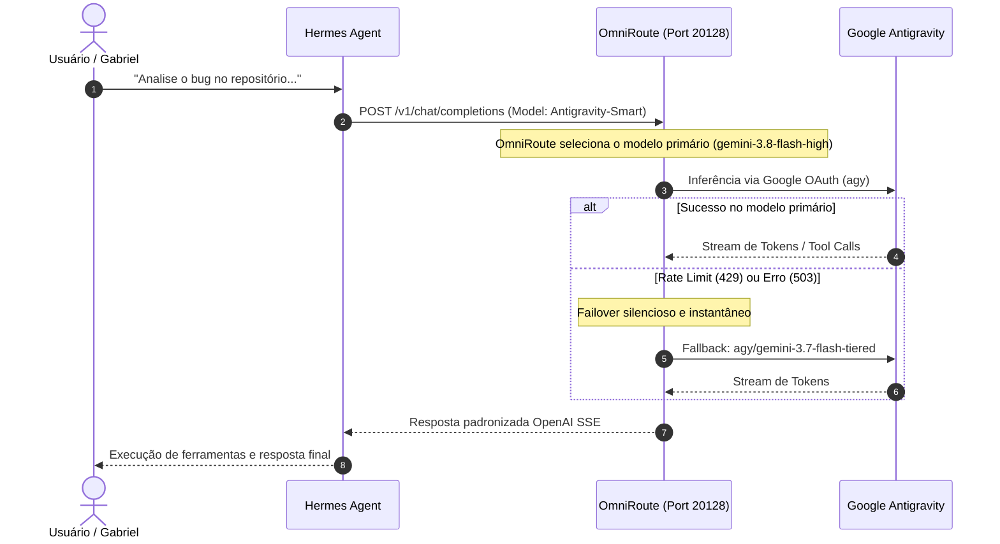

# 01.1 - Topologia e Arquitetura da Solução

O objetivo desta arquitetura é criar uma ponte de alta resiliência e custo zero entre a inferência avançada dos modelos Google (Antigravity / Gemini) e os agentes autônomos do **Hermes Agent**.

---

## 🏗️ Camadas da Arquitetura

### 1. Camada de Apresentação e Agentes (Hermes Agent)
- **Hermes CLI:** Linha de comando para interação direta, automações e scripts.
- **Hermes Desktop:** Interface gráfica avançada com suporte a Bot Mode, Sections e Group Chats.
- **Subagentes (`delegate_task`):** Instâncias filhas instanciadas em paralelo para resolver submissões de raciocínio complexo.

> Todos os componentes do Hermes interagem com o modelo via especificação padrão da OpenAI (`POST /v1/chat/completions`), utilizando a flag de compatibilidade `api_mode: codex_responses`.

---

### 2. Camada de Roteamento e Multiplexação (OmniRoute)
- Criado por Diego Souza, o **OmniRoute** atua como um middleware de IA hospedado localmente no host na porta `20128`.
- **Papel Fundamental:**
  - Gerencia as credenciais OAuth 2.0 do Google.
  - Converte as chamadas padrão da OpenAI para o protocolo de streaming e buffers exigidos pelo motor do Antigravity.
  - Encapsula políticas de retry, medição de uso de tokens e rate limiting.
  - Provê resiliência através de **Model Combos** com estratégia em cascata (*Priority Fallback*).

---

### 3. Camada de Inteligência e Inferência (Google Antigravity)
- Infraestrutura oficial da Google DeepMind / Google Cloud fornecendo acesso aos modelos:
  - `agy/gemini-3.8-flash-high`
  - `agy/gemini-3.7-flash-tiered`
- Permite raciocínio profundo (*thinking / reasoning tokens*) essencial para engenharia de software e tool calling autônomo.

---

## 🔄 Fluxo de Uma Mensagem

---

## 🔗 Próximos Passos
- Veja o racional completo em [[01 - Visão Geral/01.2 - Benefícios do Ecossistema|01.2 - Benefícios do Ecossistema]].
- Comece o setup em [[02 - Instalação & Configuração/02.1 - Google Antigravity CLI|02.1 - Instalação do Antigravity CLI]].
